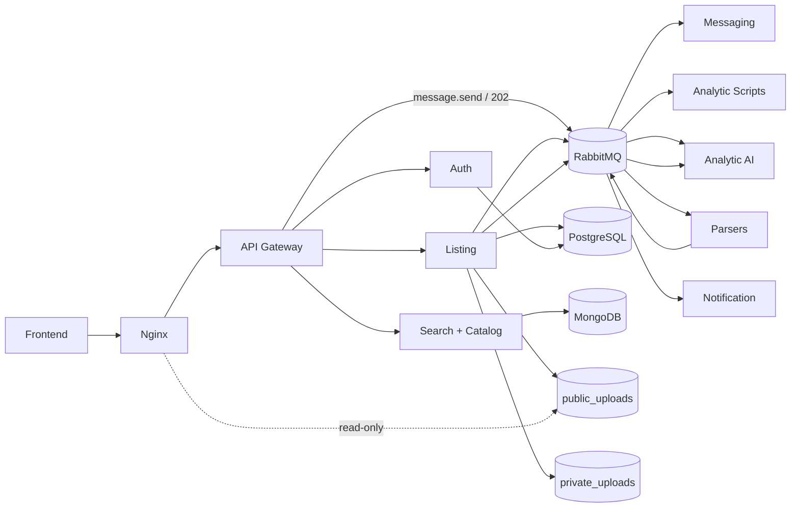

# Платформа купли-продажи готового бизнеса

Микросервисная платформа для размещения и поиска объявлений о продаже готового бизнеса.

## Возможности

- Лоты с фото, характеристиками и координатами на карте
- Поиск с фильтрами и автокомплитом
- Заявки и встроенный мессенджер (REST API и WebSocket-уведомления)
- Оценка аренды и инвестиционный скоринг (ML + эвристики)
- JWT auth (access 15 мин / refresh 7 дней), личные кабинеты

## Архитектура

| Сервис | Внутренний порт | Хранилище |
|--------|------------------|-----------|
| API Gateway | 8000 | Redis, RabbitMQ |
| Auth | 8000 | PostgreSQL, Redis |
| Listing | 8000 | PostgreSQL, файловые volumes |
| Search + Catalog | 8000 | MongoDB, Redis |
| Analytic Scripts | 8000 | MongoDB |
| Analytic AI | 8000 | PostgreSQL, Redis |
| Parsers | 8000 | MongoDB, `parsers_storage` |
| Messaging | 8000 | MongoDB, Redis |
| Notification | 8000 | MongoDB |

Инфраструктура: PostgreSQL 15, MongoDB 7, Redis 7 и RabbitMQ 3.12. Внешний трафик проходит через Nginx и API Gateway; сервисы не публикуют собственные порты.

Сервисы работают в изолированной сети Compose; внешний HTTP-трафик проходит через Nginx и API Gateway, межсервисные события идут через RabbitMQ. Analytic Scripts и Analytic AI обрабатывают объявление независимо друг от друга, Listing собирает их результаты. Для автоматического анализа AI настройте `POLZA_API_KEY` и `POLZA_MODEL`; при недоступности модели фото направляются на ручную проверку. Подробный запуск AI-сценариев из venv или Docker описан в [analytic-ai/README.md](analytic-ai/README.md).



## Быстрый старт (Docker Compose)

### 1. Настройте окружение

```powershell
Copy-Item .env.example .env
Copy-Item auth-service/.env.example auth-service/.env
Copy-Item listing-service/.env.example listing-service/.env
Copy-Item messaging-service/.env.example messaging-service/.env
Copy-Item notification-service/.env.example notification-service/.env
Copy-Item search-service/.env.example search-service/.env
Copy-Item parsers/.env.example parsers/.env
Copy-Item analytic-scripts/.env.example analytic-scripts/.env
Copy-Item analytic-ai/.env.example analytic-ai/.env
```

Заполните случайными секретами `JWT_SECRET_KEY`, `GATEWAY_SHARED_SECRET`, пароли PostgreSQL и RabbitMQ. API ключ AI задайте только в `analytic-ai/.env`. Compose читает эти файлы через `env_file`; Dockerfiles их не копируют в образы. Шаблоны `.env.example` можно хранить в Git. Для регистрации с подтверждением email заполните SMTP параметры в корневом `.env`.

### 2. Запустите платформу

```powershell
docker compose up --build -d
docker compose ps
```

Откройте `http://localhost:8080`. API доступен через `/api/`; например, Auth — `/api/auth/register`, каталог — `/api/catalog`. RabbitMQ Management UI доступен на `http://localhost:15672`.

Остановить контейнеры без удаления данных:

```bash
docker compose down
```

Данные PostgreSQL, MongoDB, Redis, RabbitMQ и загруженные файлы сохраняются в именованных Docker volumes. Для локальной разработки без Docker можно использовать инструкции виртуального окружения ниже, после запуска необходимых внешних служб и применения миграций через `make migrate`.

### Публичные и конфиденциальные файлы

Файлы объявлений загружаются через API Gateway в Listing. Публичные изображения сохраняются в `public_uploads` и доступны через Nginx по `/public/uploads/`; Listing имеет к ним доступ на запись, Nginx — только на чтение. Документы продавца сохраняются в `private_uploads`, который не подключён к Nginx.

### Остановка и логи

```bash
docker compose logs -f api-gateway auth-service listing-service
```

## RabbitMQ topology

- Exchange `listings` (topic) → `analytic.scripts`, `analytic.ai`, `listing.results`, `search_catalog.index`, `notification.listings`
- Exchange `messaging` (topic) → `messaging.in` (gateway responds `202 Accepted` after publish)
- Exchange `auth` (topic) → security events for Notification
- Legacy exchange `listings_events` remains for the original property-listing API
- Exchange `messages_events` (topic) → `notifications_queue`
- Queues declare dead-letter queues; Listing also writes events to a PostgreSQL outbox and retries delivery.

Сервисы сами объявляют exchanges/queues при старте (если брокер доступен). Без RabbitMQ/Redis сервисы стартуют с warning и продолжают работать (graceful degrade).

## Безопасность

- JWT HS256, access 15 мин, refresh 7 дней
- bcrypt 12 rounds
- CORS: `http://localhost:3000`
- Валидация входа через Pydantic v2

## Инструкции по отдельным сервисам

В каждом каталоге сервиса есть собственный README: там указаны назначение, зависимости, настройки и команды запуска через Docker Compose или локальное виртуальное окружение.

| Сервис | Инструкция |
|---|---|
| Nginx и Frontend edge | [nginx/README.md](nginx/README.md) |
| API Gateway | [api-gateway/README.md](api-gateway/README.md) |
| Auth | [auth-service/README.md](auth-service/README.md) |
| Listing | [listing-service/README.md](listing-service/README.md) |
| Search + Catalog | [search-service/README.md](search-service/README.md) |
| Analytic Scripts | [analytic-scripts/README.md](analytic-scripts/README.md) |
| Analytic AI | [analytic-ai/README.md](analytic-ai/README.md) |
| Parsers | [parsers/README.md](parsers/README.md) |
| Messaging | [messaging-service/README.md](messaging-service/README.md) |
| Notification | [notification-service/README.md](notification-service/README.md) |

## Структура

```
real-estate-aggregator/
├── docker-compose.yml         # запуск сервисов и инфраструктуры
├── shared/                    # общий Python-пакет
├── api-gateway/
├── auth-service/
├── listing-service/
├── search-service/
├── analytic-scripts/
├── analytic-ai/
├── parsers/
├── messaging-service/
├── notification-service/
├── frontend/                  # клиентская часть и API-обёртки
└── nginx/                     # внешний HTTP edge
```

## Стек

Python 3.11+, FastAPI, SQLAlchemy 2.0 async, asyncpg, Alembic, aio-pika, Redis, Pydantic v2.

## Виртуальное окружение и зависимости

Выполните команды из корневой папки проекта. Создайте окружение, активируйте его и установите все зависимости из общего `requirements.txt`.

### Windows (PowerShell)

```powershell
python -m venv .venv
.\.venv\Scripts\Activate.ps1
python -m pip install --upgrade pip
python -m pip install -r requirements.txt
```

### Linux / macOS

```bash
python3 -m venv .venv
source .venv/bin/activate
python -m pip install --upgrade pip
python -m pip install -r requirements.txt
```

Чтобы выйти из виртуального окружения, выполните `deactivate`.

## Git и GitHub

### Первый коммит и отправка проекта на GitHub

1. Установите Git и войдите в свой аккаунт на [GitHub](https://github.com/).
2. Создайте на GitHub новый пустой репозиторий. Если проект уже есть на компьютере, удобнее не добавлять при создании репозитория README, лицензию или `.gitignore`.
3. Откройте терминал в корневой папке проекта. Если Git-репозиторий ещё не создан, выполните:

```bash
git init
git branch -M main
```

4. Добавьте файлы и проверьте, что попадёт в коммит:

```bash
git add .
git status
```

5. Создайте первый коммит и привяжите удалённый репозиторий. Замените адрес на URL своего репозитория на GitHub:

```bash
git commit -m "Initial project commit"
git remote add origin https://github.com/ВАШЕ_ИМЯ/ИМЯ_РЕПОЗИТОРИЯ.git
git push -u origin main
```

`git add .` добавляет изменения и безопасные шаблоны `.env.example`; реальные `.env`, `key.txt`, приватные ключи и кэш игнорируются. Перед коммитом проверьте `git status` и убедитесь, что локальные секреты не staged.

Если команда `git remote add origin ...` сообщает, что `origin` уже существует, обновите его адрес командой `git remote set-url origin https://github.com/ВАШЕ_ИМЯ/ИМЯ_РЕПОЗИТОРИЯ.git`.

### Как отправлять следующие изменения

После того как внесли изменения в файлы, выполните из корня проекта:

```bash
git pull
git status
git add .
git commit -m "Коротко описать изменения"
git push
```

`git pull` сначала загружает последние изменения из GitHub. `git status` показывает, какие файлы изменены, `git add .` подготавливает их к сохранению, `git commit` создаёт запись об изменениях, а `git push` отправляет коммиты на GitHub. Вместо `git add .` можно добавить только нужные файлы, например `git add README.md`.

### Перед тем как сделать репозиторий публичным

Секретные файлы исключены из текущего индекса Git. Если секреты ранее попадали в коммиты, удаление из последующего коммита не стирает старую историю: замените скомпрометированные ключи и перед публикацией очистите историю репозитория. Файлы `.gitkeep` — пустые маркеры для сохранения нужных директорий.

### Отдельные машины

По умолчанию Compose адресует зависимости по Docker DNS (`rabbitmq`, `postgres`, `mongo`, `redis`). При размещении сервисов на отдельных машинах задайте соответствующие `*_URL_DOCKER` в корневом `.env` на адреса, доступные по сети, настройте firewall/TLS и передайте сервису его секреты через переменные окружения или secret store. Не используйте `localhost` для удалённой базы или RabbitMQ: внутри контейнера это сам контейнер. Общий пакет `shared/` используется Auth, Listing и Messaging и входит в их Docker images при сборке из корня этого репозитория; для независимой сборки сервиса его нужно публиковать как отдельный пакет либо включать в сборочный контекст.
