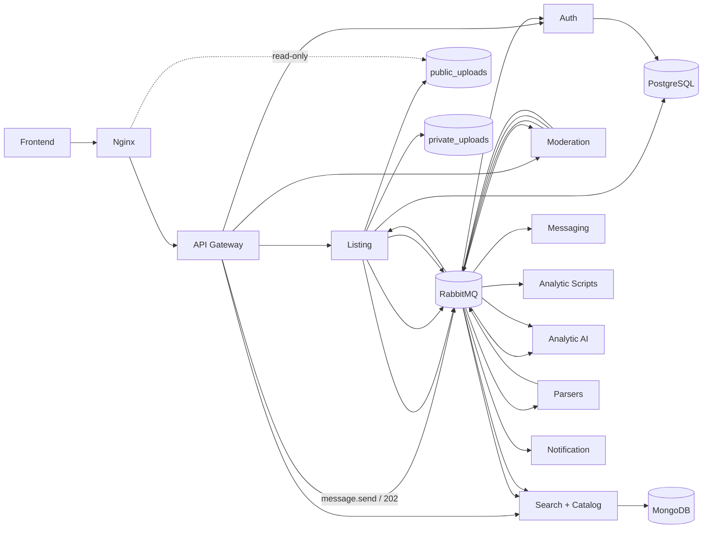

# Платформа купли-продажи готового бизнеса

Микросервисная платформа для размещения и поиска объявлений о продаже готового бизнеса.

## Возможности

- Лоты с фото, характеристиками и координатами на карте
- Поиск с фильтрами и автокомплитом
- Заявки и встроенный мессенджер (REST API и WebSocket-уведомления)
- Оценка аренды и инвестиционный скоринг (ML + эвристики)
- JWT auth (access 15 мин / refresh 7 дней), личные кабинеты

## Архитектура

| Сервис | Внутренний порт | Хранилище |
|--------|------------------|-----------|
| API Gateway | 8000 | Redis, RabbitMQ |
| Auth | 8000 | PostgreSQL, Redis |
| Listing | 8000 | PostgreSQL, файловые volumes |
| Moderation | 8000 | PostgreSQL |
| Search + Catalog | 8000 | MongoDB, Redis |
| Analytic Scripts | 8000 | MongoDB |
| Analytic AI | 8000 | PostgreSQL, Redis |
| Parsers | 8000 | MongoDB, `parsers_storage` |
| Messaging | 8000 | MongoDB, Redis |
| Notification | 8000 | MongoDB |

Инфраструктура: PostgreSQL 15, MongoDB 7, Redis 7 и RabbitMQ 3.12. Внешний трафик проходит через Nginx и API Gateway; сервисы не публикуют собственные порты.

Сервисы работают в изолированной сети Compose; внешний HTTP-трафик проходит через Nginx и API Gateway, межсервисные события идут через RabbitMQ. Analytic Scripts и Analytic AI обрабатывают объявление независимо друг от друга, Listing собирает их результаты и передаёт в Moderation только внутренний снимок на проверку. Moderation записывает решение в свой PostgreSQL и публикует событие; только после одобрения Listing отправляет публичные поля в Search. Для автоматического анализа AI настройте `POLZA_API_KEY` и `POLZA_MODEL`; при недоступности модели объявление остаётся на ручной проверке. Подробный запуск AI-сценариев из venv или Docker описан в [analytic-ai/README.md](analytic-ai/README.md).



## Быстрый старт (Docker Compose)

### 1. Настройте окружение

```powershell
Copy-Item .env.example .env
Copy-Item auth-service/.env.example auth-service/.env
Copy-Item listing-service/.env.example listing-service/.env
Copy-Item moderation-service/.env.example moderation-service/.env
Copy-Item messaging-service/.env.example messaging-service/.env
Copy-Item notification-service/.env.example notification-service/.env
Copy-Item search-service/.env.example search-service/.env
Copy-Item parsers/.env.example parsers/.env
Copy-Item analytic-scripts/.env.example analytic-scripts/.env
Copy-Item analytic-ai/.env.example analytic-ai/.env
```

Сгенерируйте случайные локальные ключи, не перезаписывая уже заданные значения:

```powershell
pwsh -ExecutionPolicy Bypass -File scripts/generate-local-secrets.ps1
```

Скрипт заполняет только отсутствующие секреты и шаблонные значения в корневом `.env`; повторный запуск сохраняет все непустые секреты. Он также создаёт пару RSA-3072 для JWT: приватный ключ передаётся только Auth, а Gateway получает только публичный ключ для проверки RS256. `.env` и вложенные `.env` исключены из Git. Compose задаёт отдельные Gateway secrets, PostgreSQL роли, Redis ACL и MongoDB пользователей для сервисов. API-ключ AI оставьте только в `analytic-ai/.env`. Секреты не копируются в Docker images.

Для намеренной ротации сгенерированных ключей используйте `-Rotate` только в согласованное окно обслуживания: смена паролей баз/Redis/RabbitMQ требует обновления учётных данных в самих хранилищах, иначе сервисы потеряют подключение. Скрипт меняет локальный `.env`, но не выполняет ротацию в запущенных хранилищах.

Для подтверждения email заполните SMTP-поля в корневом `.env` (Compose передаёт их в Auth):

- Для личного Gmail включите двухэтапную проверку аккаунта Google, создайте [пароль приложения](https://support.google.com/accounts/answer/185833) и укажите адрес Gmail в `SMTP_USER` и `SMTP_FROM_ADDRESS`. Используйте `SMTP_HOST=smtp.gmail.com`, порт `587`, `SMTP_START_TLS=true`; в `SMTP_PASSWORD` укажите пароль приложения без пробелов, а не пароль входа в Google. Это удобный вариант для разработки и небольшого MVP; Google ограничивает отправку (обычный лимит Gmail — до 500 писем в сутки), поэтому это не безлимитная почта. Актуальные параметры сервера есть в [справке Gmail по SMTP](https://support.google.com/mail/answer/7104828?hl=en).
- Для Brevo используйте `SMTP_HOST=smtp-relay.brevo.com`, порт `587`, `SMTP_START_TLS=true`, SMTP login из раздела SMTP и SMTP key в `SMTP_PASSWORD`. `SMTP_FROM_ADDRESS` должен быть проверенным отправителем; для домена потребуется настроить аутентификацию. Следуйте [инструкции Brevo SMTP](https://help.brevo.com/hc/en-us/articles/7924908994450-Send-transactional-emails-using-Brevo-SMTP); бесплатный план ограничен [300 отправками в день](https://help.brevo.com/hc/en-us/articles/208580669-FAQs-What-are-the-limits-of-the-Free-plan).

Не коммитьте `.env` и SMTP-ключи. Auth уже использует асинхронную SMTP-библиотеку `aiosmtplib`, шаблон письма, повторы при временных ошибках и Redis-защиту от повторной отправки; дополнительно действует лимит 1 письмо в минуту и не более 5 в час на адрес.

### 2. Запустите платформу

```powershell
docker compose up --build -d
docker compose ps
```

Откройте `http://localhost:8080`. API доступен через `/api/`; например, Auth — `/api/auth/register`, каталог — `/api/catalog`. RabbitMQ Management UI доступен на `http://localhost:15672`.

Перед Kubernetes production-развёртыванием прочитайте [`SECURITY_DEPLOYMENT.md`](SECURITY_DEPLOYMENT.md): внешний TLS terminator сам по себе не шифрует соединения до Pod и между сервисами, MongoDB на старом volume нужно перевести на authentication до включения `--auth`.

Остановить контейнеры без удаления данных:

```bash
docker compose down
```

Данные PostgreSQL, MongoDB, Redis, RabbitMQ и загруженные файлы сохраняются в именованных Docker volumes. Для локальной разработки без Docker можно использовать инструкции виртуального окружения ниже, после запуска необходимых внешних служб и применения миграций через `make migrate`.

### Публичные и конфиденциальные файлы

Файлы объявлений загружаются через API Gateway в Listing. Публичные изображения сохраняются в `public_uploads` и доступны через Nginx по `/public/uploads/`; Listing имеет к ним доступ на запись, Nginx — только на чтение. Документы продавца сохраняются в `private_uploads`, который не подключён к Nginx. Moderation хранит только ссылки на закрытые документы и запрашивает файл через внутренний Listing endpoint с отдельным сервисным секретом. Браузер обращается к защищённому маршруту Moderation через Gateway; Listing не публикует документы во внешнем каталоге или через Nginx.

### Карта и геокодирование

Search геокодирует только публичный адрес объявления при публикации, хранит полученную точку в своём публичном индексе и отдаёт маркеры каталогу через `POST /api/catalog/map`. Каталог и карточка объявления используют Leaflet и OpenStreetMap; документы продавца не попадают в геокодер. Search соблюдает общий лимит Nominatim через Redis и кэширует ответы. Публичный Nominatim подходит для умеренного трафика: перед production настройте `NOMINATIM_USER_AGENT` в `search-service/.env`; для большого регулярного потока установите свой экземпляр Nominatim или переключите provider endpoint. Смотрите [политику использования Nominatim](https://operations.osmfoundation.org/policies/nominatim/) и [политику OSM-тайлов](https://operations.osmfoundation.org/policies/tiles/).

### Остановка и логи

```bash
docker compose logs -f api-gateway auth-service listing-service
```

## RabbitMQ topology

- Exchange `listings` (topic) → `analytic.scripts`, `analytic.ai`, `listing.results`, `moderation.inbox`, `search_catalog.index`, Auth/Gateway/Listing blacklist consumers
- Exchange `messaging` (topic) → `messaging.in` (gateway responds `202 Accepted` after publish)
- Exchange `auth` (topic) → security events for Notification
- Legacy exchange `listings_events` remains for the original property-listing API
- Exchange `messages_events` (topic) → `notifications_queue`
- Queues declare dead-letter queues; Listing also writes events to a PostgreSQL outbox and retries delivery.
- Moderation хранит решения и блокировки в `moderation_db` и публикует их через свой PostgreSQL outbox. `moderation.user.blacklisted` снимает все объявления продавца с Search, блокирует его сессии в Auth и запрещает новые публикации; `moderation.user.unblocked` разрешает вход, но старые объявления остаются снятыми до повторной отправки и проверки.

Сервисы сами объявляют exchanges/queues при старте (если брокер доступен). Без RabbitMQ/Redis сервисы стартуют с warning и продолжают работать (graceful degrade).

## Безопасность

- JWT RS256 (приватный ключ только в Auth), access 15 мин, refresh 7 дней
- bcrypt 12 rounds
- CORS: `http://localhost:3000`
- Валидация входа через Pydantic v2

## Инструкции по отдельным сервисам

В каждом каталоге сервиса есть собственный README: там указаны назначение, зависимости, настройки и команды запуска через Docker Compose или локальное виртуальное окружение.

| Сервис | Инструкция |
|---|---|
| Nginx и Frontend edge | [nginx/README.md](nginx/README.md) |
| Frontend | [frontend/README.md](frontend/README.md) |
| API Gateway | [api-gateway/README.md](api-gateway/README.md) |
| Auth | [auth-service/README.md](auth-service/README.md) |
| Listing | [listing-service/README.md](listing-service/README.md) |
| Moderation | [moderation-service/README.md](moderation-service/README.md) |
| Search + Catalog | [search-service/README.md](search-service/README.md) |
| Analytic Scripts | [analytic-scripts/README.md](analytic-scripts/README.md) |
| Analytic AI | [analytic-ai/README.md](analytic-ai/README.md) |
| Parsers | [parsers/README.md](parsers/README.md) |
| Messaging | [messaging-service/README.md](messaging-service/README.md) |
| Notification | [notification-service/README.md](notification-service/README.md) |

## Структура

```
real-estate-aggregator/
├── docker-compose.yml         # запуск сервисов и инфраструктуры
├── shared/                    # общий Python-пакет
├── api-gateway/
├── auth-service/
├── listing-service/
├── moderation-service/
├── search-service/
├── analytic-scripts/
├── analytic-ai/
├── parsers/
├── messaging-service/
├── notification-service/
├── frontend/                  # многостраничный HTML/CSS/JS-клиент и API-обёртки
└── nginx/                     # внешний HTTP edge
```

## Стек

Python 3.11+, FastAPI, SQLAlchemy 2.0 async, asyncpg, Alembic, aio-pika, Redis, Pydantic v2.

## Виртуальное окружение и зависимости

Выполните команды из корневой папки проекта. Создайте окружение, активируйте его и установите все зависимости из общего `requirements.txt`.

### Windows (PowerShell)

```powershell
python -m venv .venv
.\.venv\Scripts\Activate.ps1
python -m pip install --upgrade pip
python -m pip install -r requirements.txt
```

### Linux / macOS

```bash
python3 -m venv .venv
source .venv/bin/activate
python -m pip install --upgrade pip
python -m pip install -r requirements.txt
```

Чтобы выйти из виртуального окружения, выполните `deactivate`.


### Отдельные машины

По умолчанию Compose адресует зависимости по Docker DNS (`rabbitmq`, `postgres`, `mongo`, `redis`). При размещении сервисов на отдельных машинах задайте соответствующие `*_URL_DOCKER` в корневом `.env` на адреса, доступные по сети, настройте firewall/TLS и передайте сервису его секреты через переменные окружения или secret store. Не используйте `localhost` для удалённой базы или RabbitMQ: внутри контейнера это сам контейнер. Общий пакет `shared/` используется Auth, Listing и Messaging и входит в их Docker images при сборке из корня этого репозитория; для независимой сборки сервиса его нужно публиковать как отдельный пакет либо включать в сборочный контекст.
